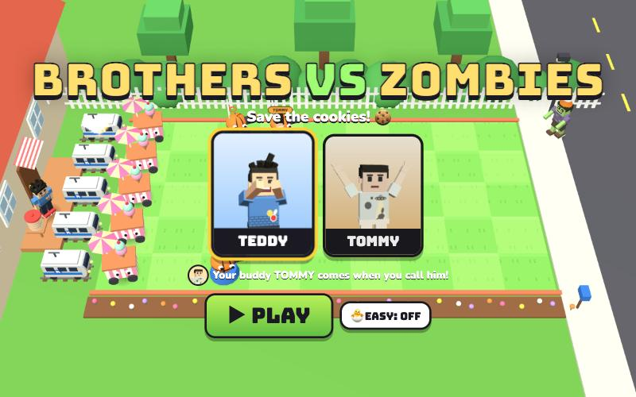

# Brothers vs Zombies

[](https://adong.github.io/brothers-vs-zombies/)

Press **?** any time (or tap the round **?** button on the left edge) to see the keys. The game waits while you look.

A lane tower-defense game starring Teddy and Tommy, built with Claude Code from plain JavaScript and Three.js.
Silly, grumpy cartoon zombies shuffle across the backyard because they want the family's cookies. Teddy and Tommy build
ice cream stands, basketball shooters and punching bags to keep them away. Nobody ever gets eaten: a defeated zombie goes
*poof* in a puff of stars and runs off down the street holding its hat.

There are no image, model or audio files. The lawn, the house, the defenders and the mini-trains are boxes, spheres and
canvas textures, the people come from the shared kit (`kit/`), and every sound is synthesised.

The working title lives in one constant, `window.BVZ_TITLE` in `js/title.js`. Change it there and the page title, the
logo and the result screens follow.

## Play

- **Double-click `index.html`.** It works offline, because Three.js and the kit are copied into `kit/`.
- **Send one file:** `dist/brothers-vs-zombies.html` is the whole game in one page (about 830 KB). AirDrop or email it, then open it in a browser.
- Rebuild that file after any edit: `python3 kit/tools/bundle.py . --name brothers-vs-zombies`
- Get kit updates from `~/claude-games/kit`: `python3 ../kit/tools/sync.py .`, then rebuild.
- The two fonts load from Google Fonts when online. Offline, the game falls back to Arial Black and the system font.
- Progress is saved in the browser, separately for Teddy and Tommy, and separately for each way of opening the game
  (so `index.html` and the dist page each keep their own).

| Touch / mouse | Keys | |
|---|---|---|
| tap a card, then tap the grass (or drag the card onto the grass) | 1–9, 0 pick a card | build a defender |
| tap a hero card, then tap any cell in a lane | | send Teddy or Tommy down that lane |
| tap a ⭐ star (or swipe across a few) | | collect it |
| the big face, bottom left | T | call your brother, as often as you like |
| 🧺 PACK UP, then tap a defender | Q | take it back (half its stars back) |
| tap the selected card again, or right-click | Esc | put the card back |
| ❚❚ | P or Esc | pause |
| 🔊 | M | sound on or off |
| title screen: TEDDY / TOMMY, 🐣 EASY, ▶ PLAY | ← → pick, E easy, Enter play | |

## How it plays

- **The yard:** a lawn of 5 lanes × 9 cells, seen from above at three-quarters. The house is on the left, with your brother
  on the porch next to the cookie jar. Zombies come in from the street on the right.
- **Stars ⭐ are the money.** They drift down from the sky (every ~8 s by day, ~11 s at night) and pop out of Ice Cream
  Stands. Tap them before they fade (12 s). A star from the sky or a stand is worth 1.
- **Build from the card bar.** Each card shows its cost. After you build, the card greys out while it recharges.
- **The mini-trains 🚇:** every lane has a little Metro mini-train parked by the porch. The first zombie that reaches the house
  in a lane sets it off: TOOT TOOT, it zooms across the lane and bonks every zombie in it. It only goes once.
- **Waves:** zombies come in waves, a little bigger each time. When the lawn is clear, the next wave hurries up. Every
  level ends with a **HUGE WAVE!** (banner and siren). The meter in the bottom right shows how close it is.
- **Win** when the huge wave is gone: Teddy and Tommy run out in front of the lawn and celebrate with their signature moves
  (Teddy's Tyson-style boxing and a basketball jump shot, Tommy's Y pose with ✌️ fingers), with confetti.
  Stars for the level: ⭐⭐⭐ with all the mini-trains still parked, ⭐⭐ if one went, ⭐ otherwise.
- **Lose** if a zombie reaches the house in a lane whose train is already gone: it strolls up to the porch and munches a
  cookie. "The zombies got the cookies!" Try again (with a tip).
- **Gentle by design:** the first level has three lanes and plain zombies, the first wave comes after 25 s, and the 1-1
  lessons ("Tap the falling stars!", "Tap the 🍦 card, then tap the grass!") show up only until you've done each thing.

### Defenders

| Card | ⭐ | Recharge | What it does |
|---|---|---|---|
| 🍦 Ice Cream Stand | 2 | 7.5 s | Makes a star every 20 s (the first after 4–7 s). Build lots of these first. |
| 🏀 Hoop Shooter | 3 | 7.5 s | Bounces a basketball down its lane every 1.5 s. |
| 🥊 Punching Bag Wall | 2 | 25 s | Ten times tougher than anything else: zombies get stuck bonking it. Teddy's boxing gloves hang on its stand, and it gets tape patches as it wears out. |
| 🍿 Popcorn Mine | 1 | 25 s | Heats up for 8 s (the lid wobbles), then goes POP! when a zombie steps on it, hitting everything within a cell. |
| ✌️ Peace Shooter | 5 | 7.5 s | Fires sleepy blue stars: a hit makes the zombie slow (half speed, blue) for 5 s. |
| 🫧 Bubble Machine | 3 | 10 s | Blows bubbles down its lane: zombies up to 5 cells ahead walk in slow motion. |
| 🤸 Bounce Pad | 1 | 20 s | BOING! Sends the first zombie that steps on it flying 3 cells back (the Boss only 1). Used up. |
| ⛹️ Double Hoop | 6 | 10 s | Two basketballs at a time. |
| 🛟 Pool Floatie | 1 | 5 s | Pool lanes only: put one on the water, then build on top of it. |

Zombies don't eat anything. When they reach a defender they stop and bonk it with both fists until it tips over.

### Hero cards

| Card | ⭐ | Recharge | |
|---|---|---|---|
| **TEDDY** | 3 | 45 s | Runs out of the house and walks down the lane you tapped, boxing every zombie he meets with Mike Tyson-style jab–straight combos (BOP! POW!). Zombies can't get past him and never hurt him. After 14 s he does a jump shot (SWISH!) and runs home. |
| **TOMMY** | 2 | 35 s | Runs to the front of the lane and does his Y pose (比耶). A ✌️ wave rolls down the whole lane and pushes every zombie 2.5 cells back, dizzy (the Boss less), popping balloons. Then he hops and runs home. |

They walk along the front edge of their lane, so the defenders never hide them. While your own brother is out on the lawn,
the porch is empty.

### Zombies

| Zombie | |
|---|---|
| Zombie | Plain and grumpy. 10 basketballs. |
| Cone-hat | An orange cone that takes 16 more hits before it pops off (PLINK!). |
| Bucket-hat | A blue sand pail: 40 more hits. |
| Skateboard | Rides fast (2.5× speed) until he bumps into a defender; the board flies off and he walks. |
| Balloon | Floats over every defender. Any hit pops the balloon (POP!) and down he comes. |
| Boss | Almost twice as tall, slow, 200 hits, bonks ten times harder, with a health bar. A crown in the day, a nightcap at night, a swim cap at the pool. In the last level of each world. |

In the pool lanes, zombies swim in rubber-duck rings.

## Your brother, the buddy

Pick who you are on the title screen. Your buddy is the other brother (`Kit.roster.buddyFor`): Tommy when you're Teddy,
Teddy when you're Tommy. Tap his big face in the bottom left, or press **T**, any time and as often as you like.

- He runs out of the house to **the lane in the most trouble** (the zombie closest to the house, plus a little for crowds),
  and stays about **10 s**. He switches lanes when his own goes quiet. A bar with his face shows the time left, and his
  button glows.
- **Teddy** boxes: jab, straight, little knock-backs. **Tommy** does his Y pose every couple of seconds and a small ✌️ wave
  pushes the zombies just ahead of him back.
- **A treat for you:** every call, he throws you a treat that lands in your brother's hand on the porch (🍦 💧 🧃 🍪 🍉 🍌,
  "🍦 ICE CREAM FROM TOMMY!"). The treat comes with **+2 ⭐**, at most once every 12 s, so tapping a lot gives lots of
  treats but not a mountain of stars.
- **He has your back:** while he's there, the first zombie to reach the house is stopped and sent packing:
  "TOMMY SAVED THE COOKIES!" The mini-train stays parked. One save per visit.
- Tapping again while he's there tops his visit back up to 10 s and brings another treat (but not another save). Tapping
  while he's heading home brings him right back.

## Worlds and levels

| Level | Name | New | You win |
|---|---|---|---|
| 1-1 | Hello, Zombies! | 3 lanes, plain zombies | 🥊 Punching Bag Wall |
| 1-2 | Cookie Smell | 3 lanes | 🍿 Popcorn Mine |
| 1-3 | Cone Party | all 5 lanes, cone-hats | TOMMY card |
| 1-4 | Busy Lawn | | ✌️ Peace Shooter |
| 1-5 | Boss of the Block 👑 | the Boss | 🫧 Bubble Machine |
| 2-1 | Night Shift | night (fewer stars), bucket-hats | 🤸 Bounce Pad |
| 2-2 | Skate Night | skateboarders | |
| 2-3 | Bucket Brigade | | ⛹️ Double Hoop |
| 2-4 | Balloon Night | balloons | |
| 2-5 | Big Bedtime Boss 👑 | the Boss in his nightcap | 🛟 Pool Floatie |
| 3-1 | Splash Zone | the pool (lanes 2 and 3), duck rings | |
| 3-2 | Pool Noodles | | |
| 3-3 | Cannonball! | | |
| 3-4 | Balloon Float | | |
| 3-5 | King of the Pool 👑 | the Boss in his swim cap | |

The level select shows each level's stars, a 👑 on boss levels, and the card you'd win. Each level opens when you've won the
one before it (per brother). The cards you have in a level are the starting three (🍦 🏀 TEDDY) plus everything won before it.
To open every level (for grown-ups testing), add `?all` to the address: `index.html?all`.

**🐣 Easy mode** (title screen or pause menu; on by default for Tommy, remembered per brother): zombies walk at 75% speed with
80% of their hits, cards recharge in 60% of the time, +3 starting stars, more stars from the sky and the stands, Popcorn heats up
faster, and stars never fade (after 8 s they fly to the counter by themselves).

## Make it yours

- **Levels and waves: `js/levels.js`.** Each level is a few readable lines:

  ```js
  {
    id: '1-3', world: 'day', name: 'Cone Party', stars: 2, first: 22, gap: 22,
    waves: ['normal', 'normal', 'cone', 'normal x2', 'normal, cone', 'normal x2', 'cone x2', 'normal x2, cone'],
    huge: 'normal x4, cone x2',
    unlock: 'tommy',
  },
  ```

  `stars` is what you start with, `first` the seconds before the first wave, `gap` the seconds between waves, `huge` the final
  HUGE WAVE, `unlock` the card you win, and `rows: [1, 2, 3]` opens only some lanes. A wave lists zombies separated by commas:
  `'normal x3'` (or `'3 normal'`), `'cone, bucket@2'` (`@2` = lane 2; 0 is the back lane, 4 the front). Types: `normal`,
  `cone`, `bucket`, `skate`, `balloon`, `boss`. A wave can also be `{ z: 'normal x2', wait: 30 }` for its own gap.
  The worlds (how often stars fall, which lanes are pool) are at the top of the file.
- **Defenders, heroes, the buddy, zombies and easy mode: `js/units.js`.** Costs, recharge times, toughness, damage, speeds.
- **After editing, check every level can still be won:** `node tools/check.js` (see below).

## Testing

`node tools/check.js` loads the game's own rules (`js/units.js`, `js/levels.js`, `js/sim.js`, `js/bot.js`) into a Node
sandbox and plays without a browser, in under 20 s:

- **Rules:** the buddy is the other brother, his treat stars and their 12 s cooldown, he saves the cookies once per visit, the
  next zombie sends the mini-train, the train clears the lane, no train left means the zombies get the cookies, Tommy's
  wave pushes back, Teddy boxes a bucket-hat until it poofs, and the pool needs a floatie.
- **Every level, 6 seeds** (`node tools/check.js 20` for 20, `node tools/check.js 20 2-5` for one level):
  - a **simple scripted build order** must win every run, in normal and in easy mode. It collects every star, puts an Ice
    Cream Stand in each lane, a shooter wherever a zombie shows up, then more shooters, punching bags and bubbles, uses the
    hero cards and a Popcorn Mine when a lane is in trouble, and never calls the buddy;
  - an **idle player** (does nothing) must lose every run, which proves the check can fail.
  - Also reported: a sloppy "kid" (late to stars, random cards in random cells) in easy mode, with and without calling the
    buddy every 25 s.
- Last run, 10 seeds: the simple build order won 150 of 150 in normal (a mini-train went in 3-3 and 3-5 now and then) and
  150 of 150 in easy; the idle player lost 150 of 150. The kid won 49 of 50 runs in world 1 and 41 of 100 in worlds 2 and 3
  on his own, and 150 of 150 when he called the buddy.

The same `js/sim.js` drives the game and a silent demo behind the title screen (the bot plays a level in a different world each time).

In the browser console, `window.game` drives the game without a mouse. That's how it was checked in the Browser pane, where
`requestAnimationFrame` is throttled while the pane is hidden:

```js
game.keepAwake(); game.hold(); game.calm()       // don't pause when hidden; only step() moves time; no CSS animations
game.start('2-4', { brother: 'tommy', easy: true, skipIntro: true })
game.autoplay()                                    // let the simple bot play this level
game.step(60)                                      // advance 60 s of game time and draw: returns a summary
game.place('peace', 2, 3)                          // build on lane 2, cell 3 ('teddy' / 'tommy' for the hero cards)
game.spawn('boss', 2, 7.5)                         // a zombie in lane 2 at cell 7.5
game.buddy()                                       // call your brother, like T
game.money(30); game.collectAll()
game.peek(2, 5)                                    // close-up camera on lane 2, cell 5; game.peek() goes back
game.win(); game.lose()                            // jump to the end scenes
game.unlockAll(); game.resetSave()
```

## Files

```
index.html          page, HUD, card bar, screens (CSS inline)
js/title.js         the game's name, in one constant
js/units.js         defenders, heroes, the buddy, zombies, easy mode: all the numbers
js/levels.js        worlds, levels and their waves
js/sim.js           the rules (no Three.js): lawn, building, zombies, shots, stars, trains, heroes, the buddy, waves
js/bot.js           scripted players for the check and the title demo
js/models.js        the yard for each world, defenders, hats and props, mini-train, textures, comic word bursts
js/sfx.js           the game's own sounds on Kit.sound.tone / hiss
js/view.js          the 3D view: keeps a model for everything in the sim, poses, effects, camera fit, win/lose scenes
js/game.js          screens, HUD, input, saving, the main loop, window.game
tools/check.js      the headless check (node tools/check.js)
kit/                copy of ~/claude-games/kit (python3 ../kit/tools/sync.py .); edit the kit there, not here
dist/brothers-vs-zombies.html   the single-page build
```

## Kit candidates

These live in this game for now. Worth moving into `~/claude-games/kit` if another game wants them:

- **Zombie variants** (`hat`, `skateboard`, `balloon`, `duckRing` and `zombieLook` in `js/models.js`): cone, sand-pail bucket,
  skate helmet, crown, nightcap and swim cap that sit on `p.head`, plus a skateboard, a balloon on a string and a rubber-duck
  swim ring. The kit's zombie wears them as is.
- **Poof and run off** (`poofZombie`, `updateLeaving` in `js/view.js`): a puff of stars, then the zombie turns and runs off with
  both hands on its head, holding its hat.
- **Facing the camera** (`turn`, `FACE_LEFT`, `FACE_RIGHT`, `FACE_CAM` in `js/view.js`): side-on walking that still shows the
  face, and turning the short way round. Standing celebrations damp the legs after `peace`/`wave` (`still`), like every sibling.
- **Particles with per-particle size and fade** in one Points draw (`makeParticles` in `js/view.js`), and comic word bursts
  (`burstTexture` in `js/models.js`: POW! BOP! POP! BOING! POOF! SWISH! TOOT TOOT!).
- **Mini Metro train** (`train` in `js/models.js`), a cookie jar, a rubber duck and googly `eyes()` for any object.
- **Sounds** (`js/sfx.js`): build, pok, ting, poof, plink, pop, boing, bubble, train toot, huge-wave siren, peace chime, treat,
  saved, win fanfare, "wah wah" lose, munch.
- **A bot-played demo behind the title** (`startDemo` in `js/game.js`), and the vm-sandbox headless check pattern.

## Not verified

- **Sound:** every effect and the music are wired up, but nobody has listened to them in this build (the test browser has no audio check).
- **Real touch devices:** taps, drags and swipes use pointer events, tested with real mouse clicks and emulated touch events
  at iPad (1024×768) and phone (844×390) sizes in the Browser pane, not with fingers on a real iPad or in iOS Safari.
- **Speed on an older iPad:** a big HUGE WAVE takes about 1,300 draw calls a frame (each blocky person is ~35 boxes). Smooth on
  this Mac; not measured on a tablet.
- **Double-clicking `index.html`:** the Browser pane can't drive `file://` pages. The game uses only classic `<script src>`
  tags and no fetches, like its siblings that do work by double-click, and the single-page build was checked over http.
